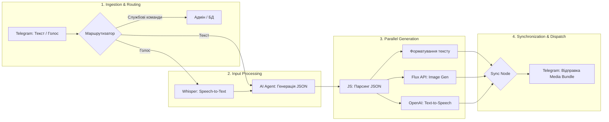

# 🤖 Telegram Prompt Architect (Multimodal AI Agent)

> Event-Driven Telegram-бот на базі n8n, який виступає "мета-інженером". Він перетворює сирі ідеї користувачів (текстові або голосові) на професійні технічні завдання (промти) для інших нейромереж (ChatGPT, Claude, Midjourney).

## 📋 Опис проєкту

Проєкт розроблявся як розумний асистент для генерації промтів. Замість того, щоб відповідати на питання прямо, бот аналізує запит користувача і створює ідеальну структуру (Persona, Context, Task, Constraints, Format). 

У процесі розвитку бот еволюціонував від простого текстового генератора до **мультимодального комбайна**, здатного паралельно генерувати текст, візуалізувати його та озвучувати результати.

---

## 📈 Еволюція архітектурних версій

### [Версія 1.0: Text-Only MVP](./v1_Lightweight_Text/)
Базова версія бота з системою маршрутизації (Router). 
* **Фічі:** Обробка команд (`/start`, `/donate`, `/help`), транскрибація голосових повідомлень (OpenAI Whisper) та генерація текстових мета-промтів з використанням AI Agent (OpenRouter) та короткострокової пам'яті (Memory Buffer).
* **База даних:** Вбудоване логування всіх запитів у Data Table для аналітики.


### [Версія 2.0: Advanced Multimodal](./v2_Advanced_Multimodal/)
Просунута версія з паралельною генерацією контенту та складною обробкою бінарних даних.
* **Як це працює:** AI-агент генерує JSON-відповідь, яка містить і текст промту, і опис картинки. Далі потік розгалужується: паралельно запитується генерація зображення через Flux API, озвучується текст через OpenAI TTS, а потім усі медіа-потоки синхронізуються (Merge node) і відправляються користувачу одним красивим пакетом.


---

## 📊 Архітектурна схема руху даних (Data Flow v2)



---

## 🚀 Ключові інженерні рішення

1. **Event-Driven Architecture:** Використання Webhook-тригерів Telegram для миттєвої реакції на повідомлення розробника та обробки натискань Callback-кнопок.
2. **LLM JSON Parsing:** Складний JavaScript-парсер, який безпечно витягує JSON із відповідей моделі (очищаючи Markdown-теги ` ```json `) та має резервні fallback-механізми на випадок галюцинацій чи помилок ШІ.
3. **Binary Data Manipulation:** Конвертація Base64 зображень, перейменування бінарних ключів (`image_data`, `audio_data`) та їх синхронізація через ноду Merge (`combineByPosition`) для коректної відправки пакета через Telegram Bot API.
4. **State Management:** Використання Window Buffer Memory з прив'язкою до `chat_id` Telegram, що дозволяє боту "пам'ятати" контекст бесіди (до 10 повідомлень) з кожним окремим користувачем.

---

## 💎 Продуктові фічі (User Experience)

Окрім чисто технічної складової, бот має продуману бізнес-логіку для взаємодії з користувачами та підтримки працездатності:
* **Monetization & Support:** Вбудована система підтримки проєкту (команда `/donate` та інлайн-кнопки) з інтеграцією платіжних банок Monobank та Privat24 для покриття витрат на сервери та API токени.
* **Feedback Loop:** Окрема гілка маршрутизації (Callback Queries `support_question` та `support_order`) для збору фідбеку, питань та пропозицій співпраці від користувачів.
* **Admin Alerts:** Система миттєвих сповіщень адміністратору в особисті повідомлення про нові цільові дії та запити у боті з передачею юзернейму та ID користувача.
* **Graceful Error Handling:** Замість "мовчання" або падіння при незрозумілих командах, бот м'яко нагадує користувачу правила взаємодії через команду `/help` або переводить текст у резервний режим.

---

## 🛠 Стек технологій

* **Оркестрація:** n8n (Advanced Routing, Binary Handling, Parallel Execution, Data Tables)
* **Штучний Інтелект:** OpenRouter (Модель `openai/o4-mini`), OpenAI API (`Whisper` для STT, `TTS` для озвучки), Flux API (`Flux.2-klein-4b` для картинок)
* **Платформа:** Telegram Bot API (Webhook mode)
* **Логіка:** JavaScript (JSON Sanitization, Payload Formatting)